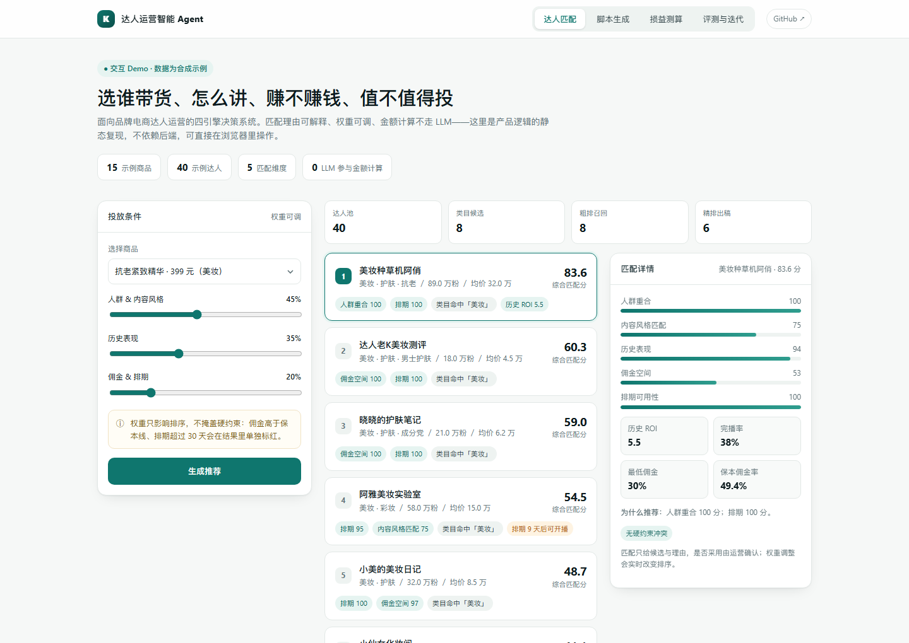
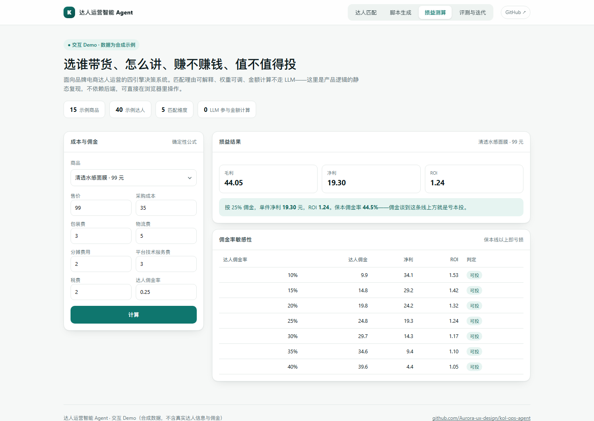
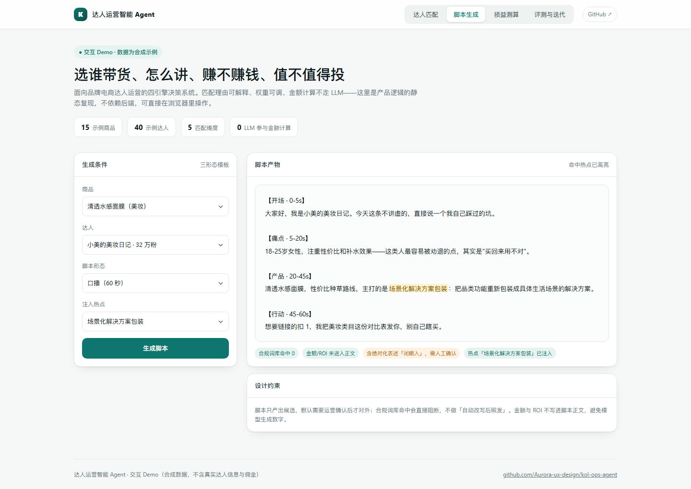
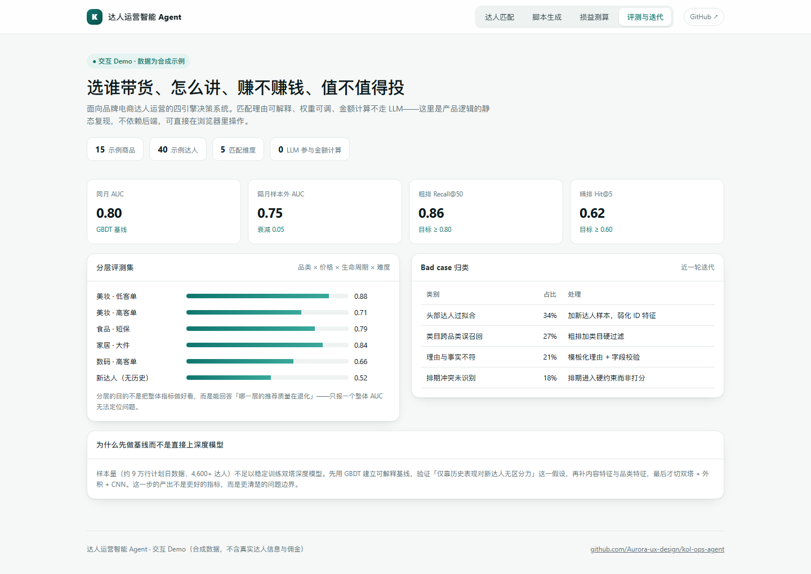
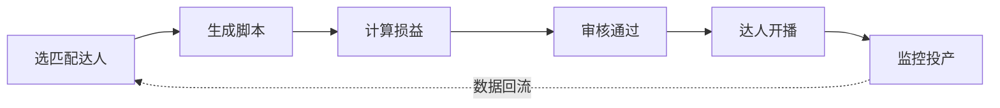

# 达人运营智能 Agent

[](https://github.com/Aurora-ux-design/kol-ops-agent/actions/workflows/ci.yml)
[](LICENSE)
[](pyproject.toml)

> 输入一个商品，Agent 告诉你应该找哪个达人、用什么脚本卖、佣金给到多少不亏、投放有没有异常。

面向品牌电商达人运营团队的 AI 决策辅助系统，覆盖达人运营全链路中四个核心决策环节——**选谁带货、怎么带货、赚不赚钱、投放值不值**。

**▶ [在线交互 Demo](https://aurora-ux-design.github.io/kol-ops-agent/)** — 纯前端静态复现，点开即可操作，无需安装（合成数据，不连 LLM）。首次使用需在 Settings → Pages 开启 `main` 分支 `/docs` 目录（见下文）。



---

## 为什么做这个项目

我做过 16 个月的快消品牌产品运营，最大的感受是：达人运营工作**重复度极高、但匹配效率极低**。同一批达人池，每次选品都要凭记忆和感觉重新想一遍"这次该找谁"；佣金谈判时手边没有实时的成本模型，只能大致估算保本线；投放开着之后基本就是"人肉盯盘"，达人在直播间到底有没有认真讲本品，品牌方其实并不知道。

市面上也有蝉圈圈这类工具，年费五六万，但用下来发现一个核心问题：**它只给一个匹配结果，不给理由，也不能调**。运营没法知道"为什么推荐这个达人"，更没法根据自己团队的经验去调整匹配逻辑——工具越黑盒，运营对它的信任度反而越低，很多时候还是回去凭手感做决策。

这个项目想验证的是：如果把"匹配理由可解释、匹配权重可调、关键决策留人工确认"这几件事做对，能不能让运营真正开始信任并依赖这套系统，而不是把它当摆设。

## 现在能做什么

| 引擎 | 状态 | 能力 | 入口 |
| --- | --- | --- | --- |
| 🎯 达人匹配 | ✅ 已实现 | 类目硬过滤 + 五维加权打分（人群重合 / 内容风格 / 历史表现 / 佣金空间 / 排期），每条结果附可读理由与硬约束风险 | `app/pages/1_达人匹配.py` |
| 📝 脚本生成 | ✅ 已实现 | 口播 / 剧情 / 测评三形态，达人风格自适应 + 热点注入 + 合规词库校验 | `app/pages/4_脚本生成.py` |
| 💰 损益计算 | ✅ 已实现 | 毛利、净利、ROI、保本佣金率的确定性计算；自然语言查询走参数解析 | `app/pages/2_损益查询.py` |
| ⚙️ 匹配权重台 | ✅ 已实现 | 五维权重与子权重可视化调整，配置落在 `config/matching_weights.json` | `app/pages/3_匹配权重.py` |
| 🔥 热点库 | ✅ 已实现 | 热点关键词维护、向量化与脚本注入 | `app/pages/5_热点库.py` |
| 🔍 投产审核 | ⏳ V3.0 规划 | 异常检测 + 直播间品控三重信号交叉验证（截帧 / 橱窗 / 口播），误判代价不对称，默认人工复核 | 未接入 |

> 早期 README 的进度清单与代码不同步（已实现的能力被标成未开始），本表按仓库当前代码校正。

## 交互 Demo

`docs/index.html` 是**单文件、零依赖**的静态复现，数据和 `data/mock/` 同源。它不调用任何后端或 LLM，用来在面试、评审、WhatsApp/微信对话里直接展示产品逻辑：

```bash
# 本地打开
start docs/index.html          # Windows
open  docs/index.html          # macOS
```

部署到 GitHub Pages 时，Settings → Pages → Source 选 `Deploy from a branch`，分支 `main`、目录 `/docs`，访问 `https://<user>.github.io/kol-ops-agent/`（截图里就是这套页面）。

| 达人匹配 | 损益测算 |
| --- | --- |
|  |  |
| **脚本生成** | **评测与迭代** |
|  |  |

Demo 里权重滑块会实时改变排序、佣金率调高到保本线上方会立刻翻红——这两处是刻意的：**策略产品的价值不在于给一个分数，而在于让人看懂分数为什么变**。

## 系统架构

四个引擎围绕一个决策闭环运转：



| 层 | 选型 | 说明 |
| --- | --- | --- |
| 操作台 | Streamlit | 桌面端运营审核台 |
| 向量检索 | ChromaDB | 达人 / 商品 / 热点 embedding 粗排 |
| 结构化数据 | SQLite | 达人池、商品库、匹配记录 |
| 模板引擎 | Jinja2 | 三形态脚本骨架 |
| LLM | DeepSeek API（OpenAI 兼容） | 语义解析、精排理由、脚本填充 |

匹配打分的权重不在代码里写死，而是读 [`config/matching_weights.json`](config/matching_weights.json)：

```json
{
  "dimension_weights": {
    "audience_overlap": 0.15,
    "content_style_match": 0.3,
    "historical_performance": 0.35,
    "commission_fit": 0.1,
    "schedule_availability": 0.1
  }
}
```

## 快速开始

```bash
python -m venv .venv && source .venv/bin/activate   # Windows: .venv\Scripts\activate
pip install -r requirements.txt

cp .env.example .env        # 填入 DEEPSEEK_API_KEY
python data/seed.py         # 写入 mock 达人/商品/热点并生成 embedding
streamlit run app/Home.py
```

首次运行 `seed.py` 会下载约 450MB 的 `paraphrase-multilingual-MiniLM-L12-v2` 权重；只想看界面可以跳过 seed，页面会提示数据为空。

## 评测与实验设计

匹配"准确率"不能只看最终 GMV：结算周期长，而且会被达人体量本身掩盖。当前采用三层前置指标：

| 阶段 | 指标 | 观察时点 |
| --- | --- | --- |
| 即时 | 运营采纳率 | 推荐当天 |
| 短期 | 达人配合率（是否按脚本讲） | 开播后 3 天 |
| 结算 | GMV / ROI 达标率 | 结算周期结束 |

模型侧的离线基线（GBDT，参考约 9 万行计划日数据、4,600+ 达人）：

| 指标 | 同月 | 隔月样本外 | 说明 |
| --- | --- | --- | --- |
| AUC | ≈ 0.80 | ≈ 0.75 | 样本量不足以训练双塔，先用 GBDT 验证特征有效性 |
| Recall@50（粗排） | 0.86 | — | 目标 ≥ 0.80 |
| Hit@5（精排） | 0.62 | — | 目标 ≥ 0.60 |
| NDCG@5 | — | — | 分层评测中统计 |

关键结论：**仅靠历史表现对新达人没有区分力**——这是后续补内容特征与品类特征的直接依据。完整评测集设计、标注规范与 bad case 归类见 [`docs/evaluation-plan.md`](docs/evaluation-plan.md)，双塔方案见 [`docs/two-tower-matching-model.md`](docs/two-tower-matching-model.md)。

数据口径：以上指标基于脱敏后的真实投放记录，仓库内 `data/mock/` 为合成数据，Demo 页面数字仅用于演示。

## 几个值得展开讲的设计判断

- **钱的计算不经过 LLM**：LLM 只负责"自然语言 → 结构化参数"和"数字 → 人话"，中间的算术全部走确定性 Python 公式，保证零误差。损益引擎的公式函数是纯函数，单测直接覆盖边界（如佣金率恰好等于保本线）。
- **品控校验用三重信号交叉验证，而不是让 LLM 直接判断"直播间在卖什么"**：截帧识别 + 橱窗扫描 + 口播关键词匹配，至少两路一致才出判定，单路不一致标记"存疑"要求人工核查。
- **自动止损默认关闭**：需要三路信号的历史准确率经过人工核查、达到可信阈值后才逐步开放，从人工到自动化是渐进的。
- **匹配"准确率"拆成分层指标**，而不是只看最终 GMV（见上节）。

## 路线图

- **V1.0（当前）**：匹配 + 脚本 + 损益三引擎最小闭环，Streamlit 操作台，静态 Demo。
- **V2.0**：飞书消息卡片（异常告警、待审核提醒）、投放数据回流与自动重排。
- **V3.0**：投产审核引擎——异常检测 + 品控三重信号交叉验证，自动止损灰度开放。
- **V4.0**：多团队协作与权限分级。

## 目录结构

```
kol-ops-agent/
├── app/              # Streamlit 操作台（只负责渲染，不写业务逻辑）
├── engines/          # 四大引擎：matching / script / profit / (audit)
├── integrations/     # LLM 与外部系统适配
├── data/             # SQLite、ChromaDB 封装与 mock 数据
├── config/           # 运营可调参数（权重、阈值、词库）
├── docs/             # PRD、评测方案、双塔设计、静态 Demo
└── tests/            # 目录结构镜像 engines/ 与 data/
```

## 开发与贡献

```bash
python -m pytest -q     # CI 跑同一套测试
```

CI 只安装测试所需的最小依赖（`pytest`、`chromadb`、`openai`、`jinja2`），不装 Streamlit 与 sentence-transformers：向量层测试用的是 fake embedding function，不需要真实模型。

欢迎提 issue 讨论运营场景下的匹配策略与评测口径。

## License

[MIT](LICENSE)
